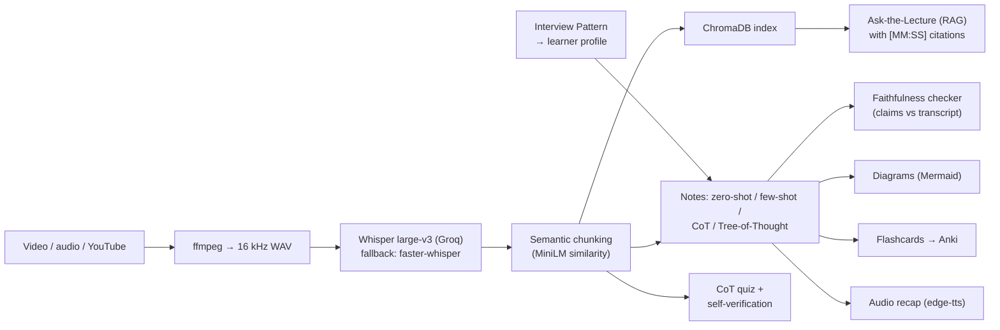

# LectureLens

Turn a recorded lecture (video, audio or YouTube link) into a personalised, grounded study kit:
timestamped notes, concept diagrams, an adaptive quiz, flashcards, an audio recap, and a chatbot
that answers questions about the lecture with citations to the exact minute. Runs on free APIs and
a CPU laptop, with no GPU.

## What it does



| Beyond an API wrapper | Where |
|---|---|
| Tree-of-Thought summariser built by hand: generate 3 candidates → judge → prune to 2 → refine with feedback → select | [pipeline/notes.py](pipeline/notes.py) |
| Faithfulness checker: atomic claims verified against the transcript by a *different* judge model | [pipeline/faithfulness.py](pipeline/faithfulness.py) |
| Experiment harness comparing zero-shot, few-shot, CoT and ToT with ROUGE, BERTScore, faithfulness and cost | [eval/run_eval.py](eval/run_eval.py) |
| Hindi / Hinglish: language detection, multilingual embeddings, Hindi TTS voices, Unicode-safe metrics | throughout |

### Syllabus mapping

| Unit | In this project |
|---|---|
| 1. Intro to GenAI (text, audio, code tools) | Whisper (speech), LLM (text), edge-tts (audio), Mermaid code generation (diagrams) |
| 2. LLMs and transformers | Model choice; context limits drive the chunk size; embeddings for retrieval |
| 3. Text generation | Notes conditioned on the learner profile; temperature/top-p experiment; ROUGE, BERTScore, faithfulness |
| 5. Multi-modal generation | Audio → text → diagrams → audio, chaining speech, language and TTS models |
| 6. Prompt engineering | Interview Pattern (profile), Chain-of-Thought (quiz, notes), Tree-of-Thought (notes) |

## Setup

Requires Python 3.10+ (tested on 3.14). ffmpeg is used from the system if present, otherwise the
binary bundled with `imageio-ffmpeg` is used, so no separate install is needed.

```bash
python -m venv .venv
.venv\Scripts\activate            # Windows   (macOS/Linux: source .venv/bin/activate)
pip install -r requirements.txt
pip install -r requirements-local.txt   # optional: offline Whisper fallback (faster-whisper)
copy .env.example .env            # macOS/Linux: cp .env.example .env
```

Add free API keys to `.env`:

- `GROQ_API_KEY` from <https://console.groq.com/keys> (Whisper large-v3 + Llama 3)
- `GEMINI_API_KEY` from <https://aistudio.google.com/apikey> (Gemini Flash)

With both keys, Gemini generates and Llama judges (the judge must differ from the generator).
With one key, the app still works; the judge falls back to a smaller model from the same provider.
**Free-tier model names and limits change often** — check them and update `.env` if a model is retired.

## Run

```bash
streamlit run app.py
```

1. **Add a lecture** in the sidebar: upload a file, paste a YouTube link, or upload a transcript
   (`.srt`, `.vtt`, or `.txt` with `[MM:SS]` lines) to skip speech recognition.
2. **Interview**: answer 3–5 questions, or pick a preset profile.
3. **Generate study kit**. Pick the prompting strategy in *Generation settings* to switch live between
   zero-shot, few-shot, CoT and ToT.
4. Explore the tabs. Every **▶ MM:SS** button jumps the player in the sidebar to that moment.

Everything is cached under `data/` and `cache/`. Saved kits reload instantly from the
*Saved study kits* menu without API calls, so **pre-process two demo lectures before a live demo**.

## Tests

```bash
python -m pytest -q
```

The end-to-end test runs the full pipeline (chunking, ToT notes, CoT quiz with self-verification,
diagram repair loop, faithfulness, RAG, exports) against a fake LLM, so it needs no keys or network.

## Evaluation

1. Copy `eval/data/manifest.example.json` → `eval/data/manifest.json` and list 5–6 lectures
   (NPTEL / MIT OCW publish transcripts; include at least one Hindi/Hinglish lecture). Put reference
   transcripts and reference notes in `eval/data/refs/`.
2. Copy `eval/data/rag_questions.example.json` → `rag_questions.json` and write ~20 questions.
3. Run:

```bash
python eval/run_eval.py                       # all six experiments
python eval/run_eval.py --exp 2 --strategies zero_shot cot tot
```

Results land in `eval/results/` as CSVs, `plots/*.png` and `tables.md` (ready to paste into the report).

| Experiment | Output |
|---|---|
| 1. Transcription WER: API large-v3 vs local small, English vs Hindi | `exp1_transcription.csv` |
| 2. Prompting strategies: ROUGE, BERTScore, faithfulness, human rating, tokens | `exp2_*.csv`, strategy and cost plots |
| 3. Sampling: temperature × top-p, Distinct-2 vs faithfulness | `exp3_sampling.csv`, trade-off plot |
| 4. Fixed vs semantic chunking: ROUGE-L and RAG accuracy | `exp4_chunking.csv` |
| 5. Personalisation: beginner vs exam profile (FK grade, length) | `exp5_personalisation.csv` |
| 6. Quiz: answerability with vs without CoT, items for human rating | `exp6_*.csv` |

Validating the judge and the human study:

```bash
python eval/judge_agreement.py export --n 20   # label 20 claims by hand, then:
python eval/judge_agreement.py score           # agreement % and Cohen's kappa
python eval/human_eval.py packet --a zero_shot --b tot   # blind A/B packet for a Google Form
python eval/human_eval.py score responses.csv            # → eval/data/human_ratings.csv
```

BERTScore uses `distilbert-base-uncased` by default so it runs on a CPU; set
`BERTSCORE_MODEL=roberta-large` for the standard (1.4 GB) model.

## Deploy

**Streamlit Community Cloud** or **Hugging Face Spaces** (Streamlit SDK): push the repo, set the main
file to `app.py`, and add `GROQ_API_KEY` and `GEMINI_API_KEY` as secrets. `packages.txt` installs ffmpeg.
Pre-processed lectures in `data/` are git-ignored; commit the two demo lectures' folders (or rebuild them
on the host) if you want them available in the deployed app.

## Project layout

```
app.py                 Streamlit UI
config.py              every tunable (models, chunk sizes, temperatures, ToT breadth/depth)
pipeline/
  ingest.py            upload / YouTube / transcript → 16 kHz WAV, 10-minute pieces
  transcribe.py        Whisper API + local fallback, timestamp offsets, cleaning
  chunk.py             semantic chunking, fixed baseline, LLM section titles
  profile.py           Interview Pattern → LearnerProfile
  notes.py             map-reduce notes; zero-shot, few-shot, CoT, Tree-of-Thought
  quiz.py              CoT MCQs, self-verification, adaptive follow-ups
  flashcards.py        cloze + Q/A cards, Anki CSV
  diagrams.py          Mermaid generation, render validation, error-feedback repair
  audio_recap.py       spoken / two-voice podcast script → MP3 (edge-tts)
  rag.py               ChromaDB (or NumPy) index, grounded answers with citations
  faithfulness.py      claim extraction and verification
  llm.py               Gemini/Groq client: cache, retries, fallback, token accounting, JSON validation
  run.py               orchestrator with per-stage caching and cost logs
prompts/               one versioned template per prompt
eval/                  metrics, experiments, plots, judge validation, human A/B
tests/                 unit + offline end-to-end tests
```

## Known limitations

- Free-tier rate limits: raise `MIN_SECONDS_BETWEEN_CALLS` or lower `MAX_WORKERS` if you see 429 errors.
  ToT costs roughly 7 LLM calls per chunk; use `TOT_BREADTH=2` for long lectures.
- LLM-as-judge bias: the judge is a different model and is validated against hand labels, but it is not ground truth.
- Whisper mis-hears technical terms; the notes inherit those errors.
- PDF export of Devanagari text needs a Devanagari font (Nirmala UI on Windows, Noto Sans Devanagari on Linux);
  Markdown export always works.
