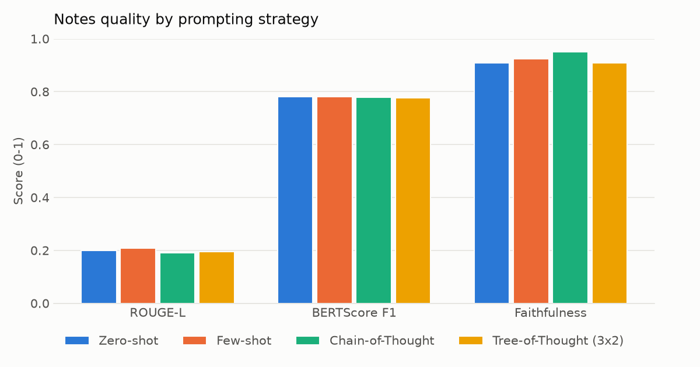
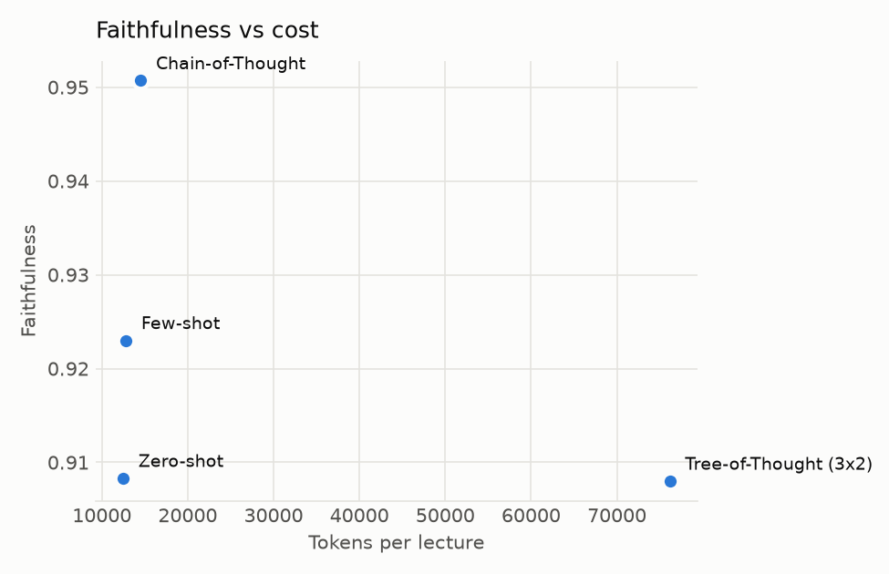
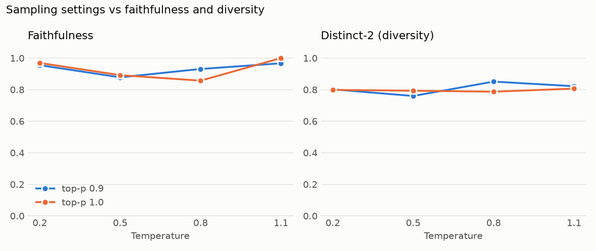

# LectureLens: results (updated 8 Nov 2026)

All numbers below come from real runs of the pipeline on six real lectures. Raw CSVs are in this folder,
plots in `plots/`, generated notes and judge verdicts in `outputs/`. Every experiment lists the models it
used; within an experiment, every configuration used the same generator and judge.

## Setup

**Dataset** (`eval/data/manifest.json`, built by `eval/prepare_dataset.py`)

| ID | Lecture | Length | Reference transcript | Reference notes |
|---|---|---|---|---|
| L1 | 3Blue1Brown: What is a neural network? | 18.7 min | human captions | author's written lesson |
| L2 | 3Blue1Brown: Gradient descent | 20.5 min | human captions | author's written lesson |
| L3 | 3Blue1Brown: Backpropagation | 12.8 min | human captions | author's written lesson |
| L4 | CrashCourse CS: Early Computing | 11.9 min | human captions | — |
| L5 | CrashCourse Biology: Photosynthesis | 13.2 min | human captions | — |
| L6 | NPTEL (Hindi/Hinglish): Probability review | 20.5 min | YouTube auto-captions (silver) | — |

No human Hindi transcript was available, so L6's reference is YouTube's own speech recognition.
22 RAG questions with reference answers were written from the human captions (`eval/data/rag_questions.json`).

**Models.** Speech: Groq Whisper large-v3 (API) and faster-whisper small int8 (local CPU).
Generators: `openai/gpt-oss-120b` (Exp 2) and `openai/gpt-oss-20b` (Exp 3, 5, 6), both on Groq.
Judge: `qwen/qwen3.8-27b` on Groq, a different model family from both generators.
Embeddings: MiniLM-L6 (English), multilingual MiniLM-L12 (Hindi).

**Why a pilot.** The free tiers allow about 20 requests/day per Gemini model and 200K tokens/day per Groq
model. The full plan needs roughly 1.5–2M tokens, so today's runs cover the most informative subset.
Everything is cached, so re-running the same commands resumes where the quota stopped (see the end).

## Pipeline: every stage works on real lectures

| Stage | Result |
|---|---|
| Ingest + transcription | 6 lectures (97 min) downloaded, converted and transcribed by the Whisper API |
| Topic-aware chunking | 4–12 chunks per lecture; boundaries fall on topic changes (e.g. L5 splits at "Calvin Cycle" and "RuBisCo") |
| Full study kit (L3) | ToT notes (4 sections, 27 bullets), 6 CoT quiz questions (6/6 passed self-verification), 30 flashcards, 4 diagrams + mind map (4/4 valid Mermaid on first try), 425-word audio recap (MP3), faithfulness 93% |

The L3 kit was a functional end-to-end check: its generator switched model mid-run when the Gemini quota
ran out, so its numbers are not used as experimental results.

## Experiment 1: transcription accuracy (WER, lower is better)

| Lecture | API large-v3 | Local small | Local time (CPU) |
|---|---|---|---|
| L1 | 3.0% | 0.9% | 632 s for 18.7 min |
| L2 | 3.9% | 3.9% | 848 s for 20.5 min |
| L3 | 2.9% | 2.9% | 481 s for 12.8 min |
| L4 | 7.3% | 6.5% | 538 s for 11.9 min |
| L5 | 5.0% | 5.4% | 427 s for 13.2 min |
| **English mean** | **4.4%** | **3.9%** | ~0.6× real time |
| L6 (Hindi, silver ref.) | 62.2% | 83.4% | (CPU was shared with other runs) |

- On clean English lectures the small local model is as accurate as the API model, at about 0.6× real time on a laptop CPU.
- **L6 WER is not comparable to the English numbers.** The API model writes code-switched English terms in
  Latin script ("probability theory", 36% of its words), while the reference writes everything in Devanagari,
  so each correctly recognised English term counts as an error. Reading the transcripts, large-v3 produces
  accurate Hinglish, while the small model garbles technical terms ("प्रोभबिलिटी खेरी" for "probability theory").
  A human Hinglish transcript is needed for a real Hindi WER.

## Experiment 2: prompting strategies (the main result)

Generator `gpt-oss-120b`, judge `qwen3.8-27b`, neutral learner profile, the three lectures with reference
notes (L1–L3). Claims the judge could not assess are excluded and counted ("unjudged": 1 of 863 claims).

**Mean over L1–L3**

| Strategy | ROUGE-L | BERTScore F1 | Faithfulness | Tokens per lecture |
|---|---|---|---|---|
| Zero-shot | 0.200 | **0.782** | 0.908 | 12,482 |
| Few-shot | **0.207** | 0.780 | 0.923 | 12,815 |
| Chain-of-Thought | 0.190 | 0.779 | **0.951** | 14,533 |
| Tree-of-Thought (3×2) | 0.195 | 0.776 | 0.908 | 76,182 |

**Faithfulness per lecture**

| Strategy | L1 | L2 | L3 |
|---|---|---|---|
| Zero-shot | 0.943 | 0.922 | 0.860 |
| Few-shot | **0.955** | 0.871 | 0.943 |
| Chain-of-Thought | 0.953 | **0.929** | **0.970** |
| Tree-of-Thought (3×2) | 0.913 | 0.875 | 0.936 |

- **Chain-of-Thought gives the most faithful notes**: best mean (0.951), best on two lectures and within
  0.002 of the best on the third, and above zero-shot on all three, for only ~16% more tokens.
- **Tree-of-Thought does not pay off here**: about 6× the tokens of zero-shot for the same mean faithfulness
  (0.908). Its candidates are generated at temperature 0.8 for diversity, and the judge-and-refine loop does not
  fully remove what that adds; a single careful CoT pass is both cheaper and more faithful.
- Few-shot is best on word overlap (ROUGE-L), but its faithfulness varies most between lectures.
- ROUGE-L and BERTScore barely separate the strategies: the reference is the author's prose lesson, not
  bullet notes, so overlap is low for every strategy. Faithfulness is the more informative metric here.
- Three lectures is a small sample: CoT beating zero-shot on 3 of 3 lectures is a consistent direction, not
  a statistically significant result (sign test p = 0.125). Human ratings would strengthen it.

## Experiment 3: sampling (temperature × top-p)

Generator `gpt-oss-20b`, judge `qwen3.8-27b`, zero-shot notes on L3, one sample per setting.

| Temperature | Faithfulness (top-p 0.9 / 1.0) | Distinct-2 (top-p 0.9 / 1.0) |
|---|---|---|
| 0.2 | 0.955 / 0.969 | 0.802 / 0.799 |
| 0.5 | 0.878 / 0.892 | 0.760 / 0.793 |
| 0.8 | 0.931 / 0.857 | 0.851 / 0.787 |
| 1.1 | 0.967 / 1.000 | 0.822 / 0.807 |

**No temperature trend.** The expected trade-off (more diverse, less faithful as temperature rises) does not
appear. Likely reasons: one lecture and one sample per setting, so noise dominates; and `gpt-oss-20b`
reasons before it answers, which may dampen sampling effects on the final text. Repeating each setting
3–5 times on 2–3 lectures is needed before drawing a conclusion.

## Experiment 4: fixed vs semantic chunking (retrieval)

Retrieval only (no LLM): for each question, where does the chunk that teaches the answer rank? Gold
locations are every human-caption line containing the answer's keywords; chunks are embedded without
titles so only the boundaries differ. 20 answerable questions over L1–L5.

| Chunking | Chunks per lecture | Mean tokens | Hit@1 | MRR | Hit@4 |
|---|---|---|---|---|---|
| Fixed 1,000 tokens | 4.4 | 829 | 0.65 | 0.79 | 0.95 |
| Fixed, size-matched | 6.4 | 579 | 0.85 | 0.90 | 0.95 |
| **Semantic** | 5.4 | 691 | **0.90** | **0.95** | **1.00** |

Semantic chunking puts the right section first most often. The size-matched arm separates the two effects:
most of the gain over 1,000-token chunks comes from smaller chunks, the rest from where the boundaries fall.
With 20 questions this is a trend, not a significant result. The LLM half of this experiment (notes ROUGE-L
and answer accuracy per chunking) has not run yet.

## Experiment 5: personalisation

Generator `gpt-oss-20b`, zero-shot notes for two learner profiles, four lectures (one Hindi).

| Lecture | Profile | Words | Bullets | Definitions | FK grade |
|---|---|---|---|---|---|
| L3 | Beginner | 876 | 25 | 7 | 15.7 |
| L3 | Exam revision | 716 | 26 | 3 | 15.1 |
| L4 | Beginner | 1,238 | 43 | 7 | 14.1 |
| L4 | Exam revision | 996 | 34 | 8 | 14.9 |
| L5 | Beginner | 1,127 | 35 | 19 | 13.4 |
| L5 | Exam revision | 887 | 31 | 14 | 12.8 |
| L6 (Hindi) | Beginner | 2,061 | 51 | 25 | 12.2 |
| L6 (Hindi) | Exam revision | 1,645 | 44 | 19 | 10.9 |
| **Mean** | **Beginner** | **1,326** | **38.5** | **14.5** | **13.8** |
| **Mean** | **Exam revision** | **1,061** | **33.8** | **11.0** | **13.4** |

The profile clearly conditions the output: on every lecture the beginner notes are longer (+25% words on
average, 22–27% per lecture) and, in total, contain more definitions (58 vs 44). The Flesch-Kincaid grade
does not move consistently (higher for beginners on 3 of 4 lectures), because FK rewards short sentences and
the "detailed" beginner explanations use longer ones. FK is a weak proxy for conceptual difficulty here.

## Experiment 6: quiz quality, with vs without Chain-of-Thought

Generator `gpt-oss-20b`, verifier `gemini-3.5-flash-lite` (answers each question without seeing the key).

All six lectures, 10 questions per lecture and variant.

| Variant | Questions | Passed self-verification first time | Mean tokens per lecture |
|---|---|---|---|
| No CoT | 60 | 59 (98.3%) | 11,733 |
| CoT | 60 | 60 (100%) | 11,186 |

Both variants are at the ceiling: almost every question generated from the transcript was answerable by the
verifier reading the same transcript (the one failure, on L1, was regenerated and then passed).
Self-verification cannot separate the variants on these lectures. The difference the plan expects
(distractor quality) needs the human ratings: the 120 questions are in `exp6_questions_for_rating.csv`,
with the variant hidden in the item code.

## LLM-as-judge validation

A stratified sample of 30 claim verdicts from the Experiment 2 judge (`qwen3.8-27b`) was re-judged by a
model from a third family (`gemini-3.1-flash-lite`), with the same evidence and prompt
(`judge_agreement.py crosscheck`, results in `judge_crosscheck.csv`).

| | Cross-judge: supported | not mentioned | contradicted |
|---|---|---|---|
| **Main judge: supported** | 13 | 0 | 0 |
| **not mentioned** | 5 | 8 | 0 |
| **contradicted** | 1 | 2 | 1 |

Exact agreement **73%**, supported-vs-not agreement **80%**, Cohen's kappa **0.54** (moderate). Every
disagreement goes the same way: the main judge is the stricter of the two (it never calls a claim supported
when the cross-judge does not). Faithfulness scores in this report are therefore conservative. Hand-labelling
20 verdicts (`judge_agreement.py export` / `score`) is still needed to say which judge is closer to a person.

## Bugs found and fixed by running on real data

- Faithfulness counted claims the judge never assessed (API errors) as unsupported; ToT's L3 score read
  0.70 instead of 0.94. Unjudged claims are now excluded and reported, and the check is retried.
- The WER reference kept `[MM:SS]` line prefixes, inflating English WER from ~4% to ~17%.
- Groq counts `max_tokens` against the per-minute budget up front, so judge calls now use small per-task caps.
- Quiz verification passed questions silently when the verifier was unreachable; they are now marked unverified.
- faster-whisper 1.2.1 fails with current PyAV; audio is now passed as samples.
- Provider fallback could silently swap the judge for the generator model; it is now disabled in experiments
  and in the judge cross-check.

## To complete the full plan

`python eval/run_pending.py` runs everything that is left, in order, waiting out daily quotas; cached work
is skipped. Remaining: the LLM half of Experiment 4, the demo study kits (`scripts/build_demo_kits.py`) and
Experiment 3 repeats (3 samples per setting).

Still manual by design: human ratings (Google Form, `eval/human_eval.py`) and hand-labelling 20 judge
verdicts (`eval/judge_agreement.py export` / `score`).
